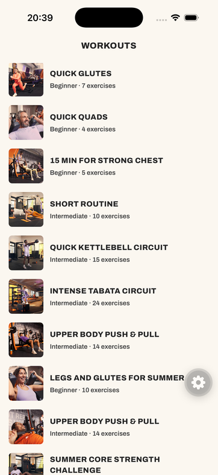
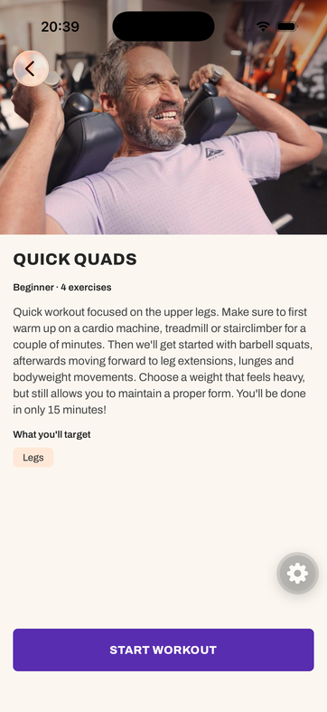
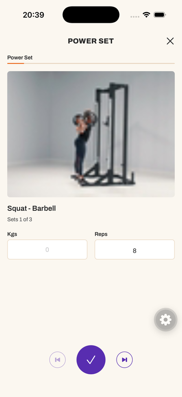
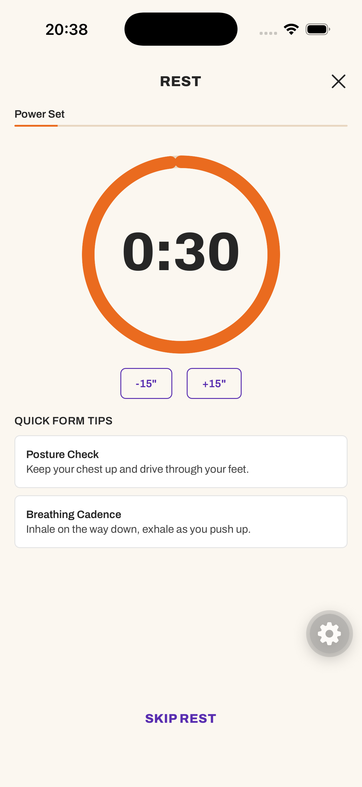
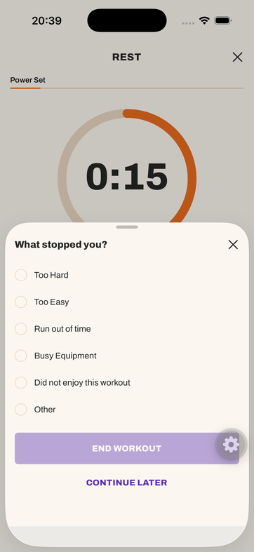
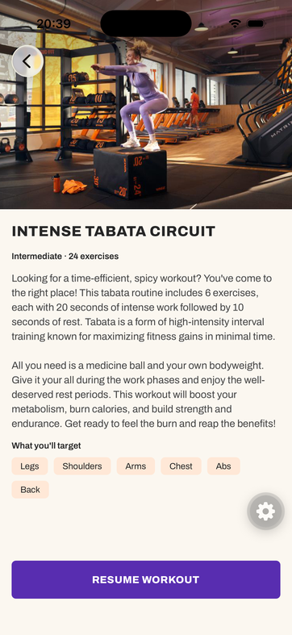
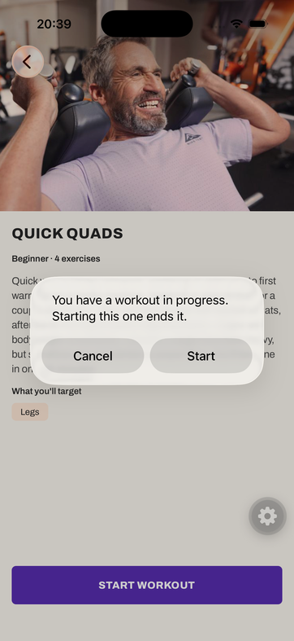
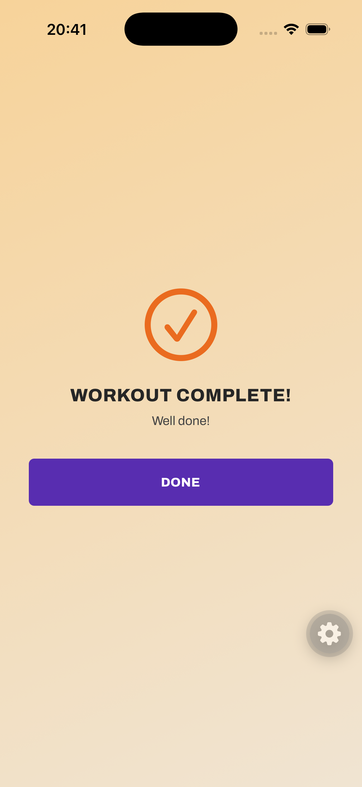

# Workout Player

## Screenshots

| Workouts                                                    | Details                                                        | Exercise                                                    | Rest                                                |
| ----------------------------------------------------------- | -------------------------------------------------------------- | ----------------------------------------------------------- | --------------------------------------------------- |
|  |  |  |  |

| Stop sheet                                                | Resume                                                        | Active workout alert                                                | Complete                                                        |
| --------------------------------------------------------- | ------------------------------------------------------------- | ------------------------------------------------------------------- | --------------------------------------------------------------- |
|  |  |  |  |

## Running

The app runs in a development build, not Expo Go, because MMKV is a native module that Expo Go doesn't bundle.

### Prerequisites

- macOS with Xcode and an iOS Simulator
- Node 24 LTS (`.nvmrc`)
- [Bun](https://bun.sh)

### Setup

```bash
git clone https://github.com/LondyF/react-native-assignment.git
cd react-native-assignment
nvm use
bun install
```

The Contentful endpoint and delivery token are committed in `.env`, so there is nothing to configure. I wouldn't normally commit an `.env` file, but the token is the read-only one from the brief, so I did it for simplicity.

### Run

```bash
bun run ios
```

The first run generates the native project, builds it and opens the simulator, which takes a few minutes. Afterwards `bun run start` is enough, then press `i`. On Android, use `bun run android` with Android Studio and an emulator.

If Metro isn't on port 8081, the app won't find it. Open `workoutplayer://expo-development-client/?url=http%3A%2F%2Flocalhost%3A<port>` in the simulator.

### Check

```bash
bun run check
```

This runs lint, Prettier, TypeScript and the tests.

## Decisions

- **Expo SDK 58 in a development build**, not Expo Go. The SDK 58 Expo Go isn't in the stores yet, and MMKV needs a native build anyway.
- **Zustand persisted to MMKV** for session progress. MMKV reads synchronously, so the store is restored before the first frame and resuming needs no loading gate. The timer is stored as an `endsAt` timestamp, so a rest that was running when the app closed is still correct on reopen.
- **TanStack Query for the workout, Zustand for the session.** When a workout starts, it is flattened into a list of steps (each set, timed exercise and rest) and that list is saved in the session. This way it's peristed.
- **Plain `fetch` and Zod** instead of a GraphQL client. Chosen for simplicity.
- **Uniwind/Tailwind for styling.** Animated styles use the `style` prop, since it doesn't translate `className` into Reanimated animations.
- **Feature folders** (`workout`, `workout-session`) with `api/`, `model/`, `store/`, `hooks/` and `components/` layers. Dependencies run one way, and an ESLint rule blocks deep imports into a feature.

## Project structure

```text
src/
  app/                   Expo Router routes. Each one renders a screen.
  screens/               One component per route. Wires navigation to the feature components.
  components/            UI used by more than one feature (button, error state, icon).
  lib/                   Shared setup: MMKV adapter, query client, Contentful client.
  features/
    workout/             The workout from Contentful (server state).
      api/               Fetch and TanStack Query options.
      model/             Zod schemas and types.
      hooks/             useWorkout, useWorkouts.
      components/        Workout list and details.
    workout-session/     The user's progress through a workout (local state).
      model/             Step building, timer maths, navigation. Pure TypeScript.
      store/             Zustand store persisted to MMKV.
      hooks/             React bindings, countdown, pause on background.
      components/        Player UI: exercise, rest, stop sheet, complete.
```

Each feature exposes its public API through an `index.ts`. `workout-session` imports from `workout`, never the other way around, because a workout is just data and shouldn't know whether anyone is playing it. Tests and other feature related files are colocated to the feature.

## Persisting and restoring progress

The session store saves five fields: `status`, `workoutId`, `steps`, `stepIndex` and `timer`. `steps` is the workout flattened into playback order when it starts, and `stepIndex` is the position in that list. Saving the list, not just the position, means the index always points at the same exercise, even if the workout changes in Contentful or the app updates how steps are built.

On launch, the store is restored from MMKV (using Zustand Persist) before the first render. If a session is active, the root layout opens that workout's details screen, which now shows "Resume workout". Resuming opens the saved step directly.

## Edge cases

- **App closed mid-workout:** current step is saved in MMKV, so reopening the app will give the user the option to resume the workout
- **App closed during a rest:** the timer is stored as an `endsAt` timestamp (or `remainingMs` when paused), so the countdown is correct on reopen.
- **Workout completed or ended:** only `active` sessions are persisted, so the stored state is cleared.
- **API request fails or the workout is unavailable:** Using React Query defaults. APIs are retried 2 times, after that a 'retry' button wil show.
- **Workout changed in Contentful during a session:** the session keeps playing the steps it started with. The new content applies from the next start.
- **Session saved by an older build:** it is discarded, and the user starts the workout again.
- **Missing rest in Contentful:** some exercises have fewer rest values than sets, and timed exercises have none. Those get a default rest of 30 seconds
- **Timer reaches zero or is adjusted repeatedly:** We always clamp the time to 0, therefore timer cannot exceed 0.

## Known limitations

- Next on a timed exercise skips its rest as well, like Next on a set. Only completing the exercise (or letting the countdown run out) goes into the rest.
- Kgs and Reps are local component state. They are not stored or persisted, so they reset when the set changes or the app restarts. The fix is a `setLogs` map in the session store, keyed by step index and written by `next`.
- An in-progress session doesn't pick up workout changes made in Contentful (for example a corrected rep count) until it is started again.
- The stop reason is not stored. End workout only requires one to be picked.
- The stop sheet has a "Continue later" action that the design does not show. It leaves the session active, so a workout can be left and resumed without closing the app.
- The stop sheet looks cut off at the bottom on iOS. Due to time constratins, I haven't looked into fixing this.

## AI usage

- AI was used to implement the design.
- AI was used to speed up development. The architectural decisions are mine.
- AI wrote the data transform in `workout-schema.ts`, which turns the Contentful response into the app's workout model (for example, durations given as either seconds or `[hours, minutes, seconds]`, and rest values given as numbers or strings).
- All tests are AI-generated. Due to time constraints, I have not reviewed them.
